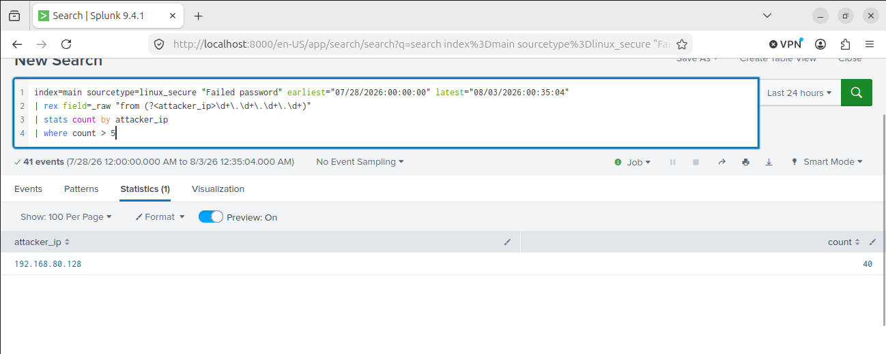
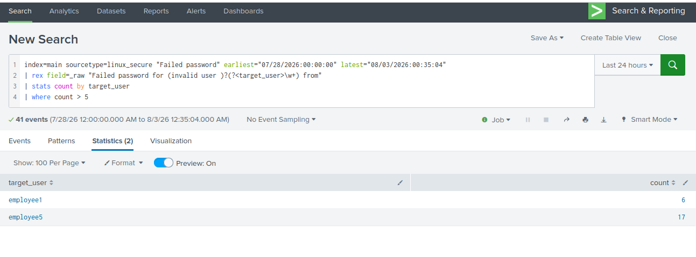
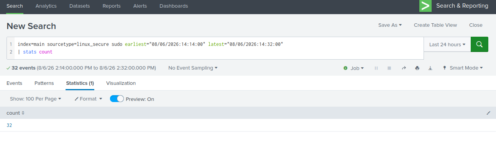
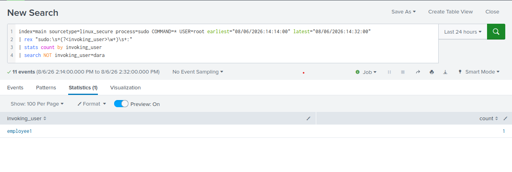
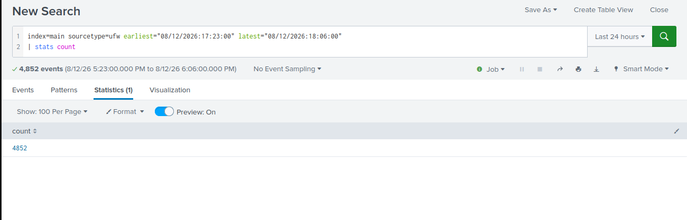
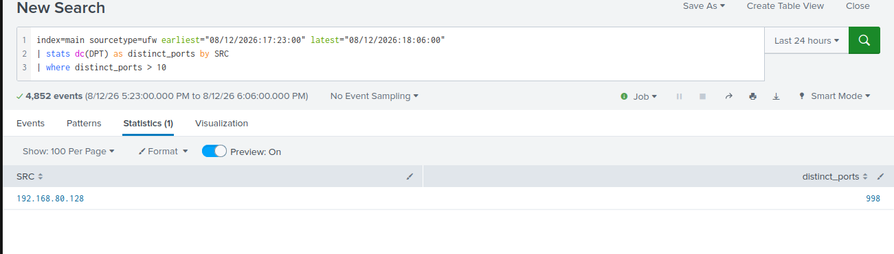

# SIEM Rule Tuning for Reducing Alert Fatigue

My MSc Cybersecurity dissertation at the University of Hertfordshire (Distinction, project graded 80%).

I built a small SOC lab in Splunk, attacked it three different ways, and tuned the detection rules by hand to cut false alarms without missing the real attacks.

| Attack | Kind of problem | Before tuning | After tuning | Real attack still caught |
| --- | --- | --- | --- | --- |
| SSH brute force (Hydra) | Volume | 41 benign alerts | 2 accounts flagged | Yes, root with 310 failures |
| Privilege escalation (sudo misconfiguration) | Context | 11 sudo commands (32 raw lines) | 1 | Yes, employee1 |
| Port scanning (Nmap) | Precision | 4,852 firewall events | 1 scanning source | Yes, Kali with 998 ports |

The main finding: each attack needed a different kind of fix. Brute force needed grouping by user, privilege escalation needed knowing who is authorised, and port scanning needed counting distinct ports instead of events.

The full write up, including the mistakes I made and fixed along the way, is in the case study PDF in this repository.

## The lab

Everything ran in an isolated virtual network in VMware Workstation on my own laptop. No real systems were touched.

| Part | What I used |
| --- | --- |
| Target | Ubuntu (192.168.80.130) |
| SIEM | Splunk Enterprise 9.4.1, collecting auth.log, syslog and the UFW firewall log |
| Attacker | Kali Linux (192.168.80.128) |
| Users | Seven employee accounts plus an admin account, generating normal activity |

For every attack I kept a benign window with only normal staff activity and a separate attack window. A good rule should stay quiet in the first and still catch the attack in the second.

## Attack 1: SSH brute force

Grouping failed logins by source IP gave one useless alert, because all the employees and the attacker shared the same machine. Grouping by the account being targeted flagged only 2 employees and still caught root with 310 failures.

| Before | After |
| --- | --- |
|  |  |

## Attack 2: privilege escalation

21 of the 32 raw sudo lines were automatic PAM messages, not people. The real attack looked exactly like a normal admin command, so the fix was to tell the rule who is allowed to act as root.

| Before | After |
| --- | --- |
|  |  |

## Attack 3: port scanning

My first scan only logged 10 ports because the firewall's logging was rate limited. I fixed it with high logging and a 20ms scan delay. Normal traffic never touched more than 4 ports per machine, so a threshold of 10 isolated the scanner cleanly.

| Before | After |
| --- | --- |
|  |  |

## Files

| File | What it is |
| --- | --- |
| SIEM_Rule_Tuning_Case_Study.pdf | The full case study |
| detection-searches-and-lab-setup.txt | Every SPL search, attack command and lab setup command I used |
| screenshots/ | Before and after results from Splunk |

## Tools

Splunk Enterprise, SPL, Kali Linux, Ubuntu, Hydra, Nmap, UFW, VMware Workstation
